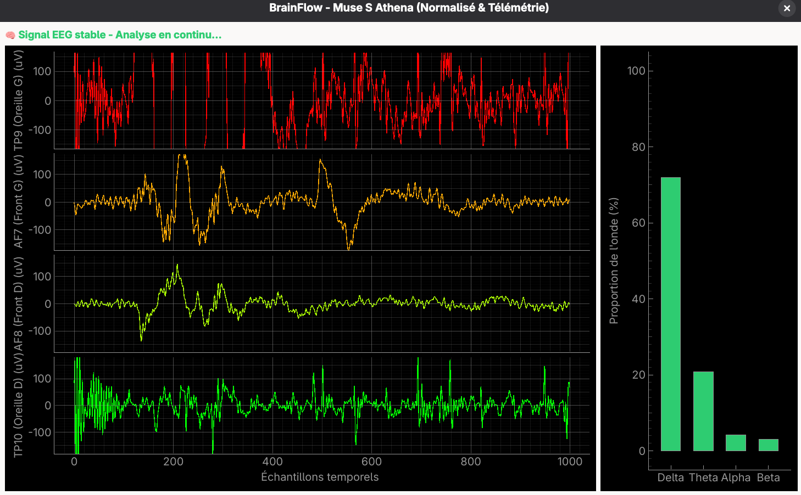

# Guide d'installation : Stream EEG avec Muse S Athena sur Linux (VS Code)

Ce projet permet de configurer votre système Linux, de créer un environnement virtuel Python isolé sous VS Code et de récupérer puis visualiser les signaux EEG de votre bandeau **Muse S Athena** en temps réel à l'aide de la bibliothèque **BrainFlow**.

## Aperçu du tableau de bord (`dashboard.py`)

L'interface graphique affiche les signaux EEG filtrés pour chaque canal ainsi qu'une décomposition spectrale dynamique des ondes cérébrales :



---

## 1. Prérequis système & pile bluetooth (BlueZ)

Le bandeau Muse S Athena communique via le protocole Bluetooth Low Energy (BLE). Vous devez installer la pile Bluetooth standard et démarrer le service en fonction de votre distribution.

Ouvrez un terminal système et exécutez les commandes adaptées :

### 🔹 Option A : Arch Linux (KDE / Gnome)
```bash
sudo pacman -S bluez bluez-utils python-pip python-virtualenv dbus
sudo systemctl enable --now bluetooth
```

### 🔹 Option B : Ubuntu / Debian / Linux Mint (Gestionnaire `apt`)
```bash
sudo apt update
sudo apt install bluez bluez-tools python3-pip python3-venv dbus
sudo systemctl enable --now bluetooth
```

### 🔹 Option C : Fedora / RHEL / CentOS (Gestionnaire `dnf`)
```bash
sudo dnf install bluez bluez-utils python3-pip dbus
sudo systemctl enable --now bluetooth
```

---

## 2. Récupération de l'adresse MAC du Muse S

Pour que le script Python cible le bon appareil, vous devez identifier l'adresse physique (MAC) de votre bandeau.

1. Allumez votre Muse S Athena (la LED doit pulser doucement).
2. Ouvrez l'outil de configuration Bluetooth de votre interface graphique ou utilisez le terminal :
   ```bash
   bluetoothctl
   ```
3. Dans l'invite `[bluetooth]#`, lancez la recherche d'appareils :
   ```bash
   scan on
   ```
4. Repérez une adresse au format `00:55:DA:XX:XX:XX` nommée **MuseS-XXXX**. Notez cette adresse MAC précieusement.
5. Quittez l'outil :
   ```bash
   quit
   ```
*Note : Le bandeau doit rester libre ("unpaired"). Ne l'associez pas manuellement dans les paramètres Bluetooth de votre système.*

---

## 3. Configuration de l'environnement sous VS Code

### Étape 3.1 : Installation de l'extension officielle Python
1. Ouvrez votre dossier de projet dans VS Code (*Fichier > Ouvrir le dossier...*).
2. Ouvrez l'onglet des Extensions (`Ctrl + Shift + X`).
3. Recherchez **Python** (éditée par **Microsoft**) et cliquez sur **Installer**.

### Étape 3.2 : Création de l'environnement virtuel (`venv`)
1. Ouvrez le terminal intégré de VS Code (`Ctrl + \``).
2. Créez un environnement virtuel isolé nommé `.venv` en exécutant :
   ```bash
   python3 -m venv .venv
   ```
3. Si VS Code vous propose d'utiliser cet environnement pour le dossier de travail, acceptez (**Oui / Yes**).

### Étape 3.3 : Installation des dépendances
1. Vérifiez que votre terminal intégré affiche bien le préfixe **`(.venv)`** au début de votre ligne de commande.
2. Installez les paquets à l'aide du fichier `requirements.txt` :
   ```bash
   pip install -r requirements.txt
   ```

---

## 4. Exécution
* Pour le script de capture rapide (5 secondes) : 
  ```bash
  python main.py
  ```
* Pour le tableau de bord temps réel graphique : 
  ```bash
  python dashboard.py
  ```